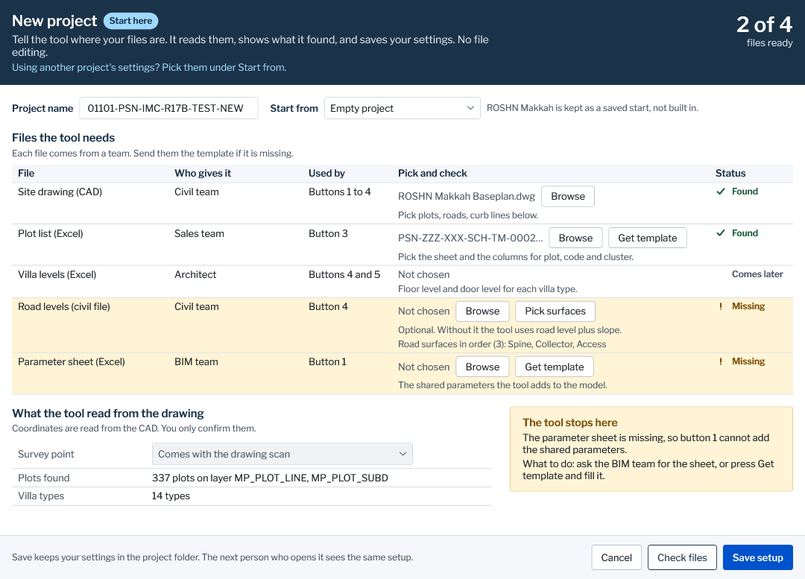
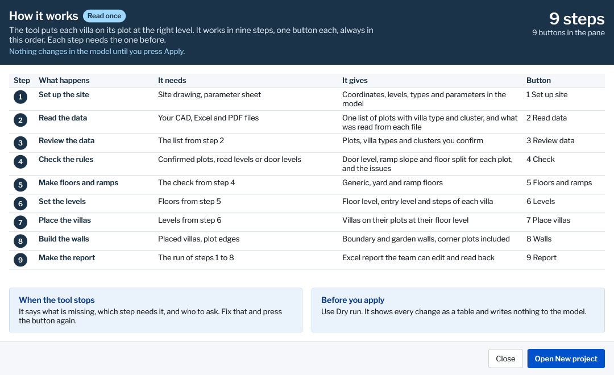
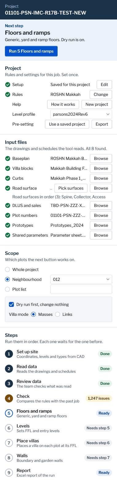
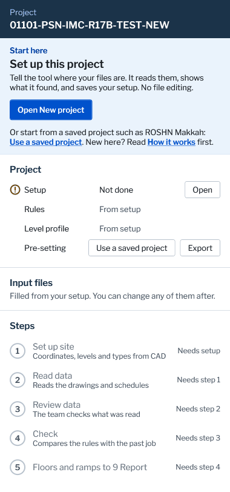
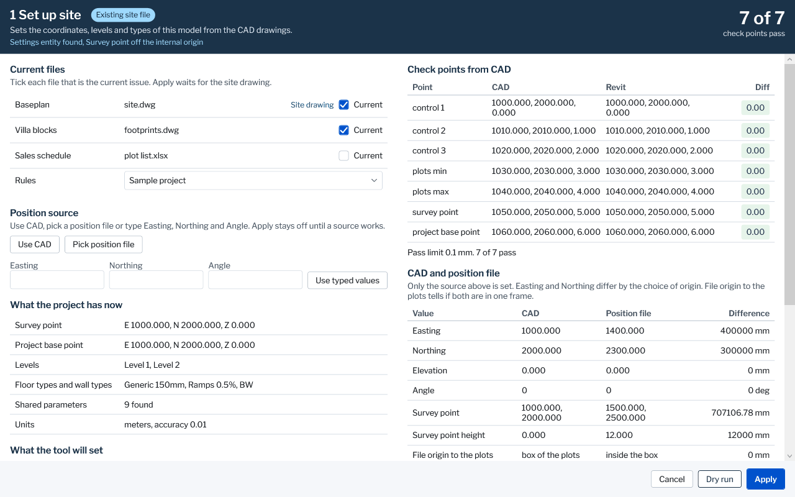
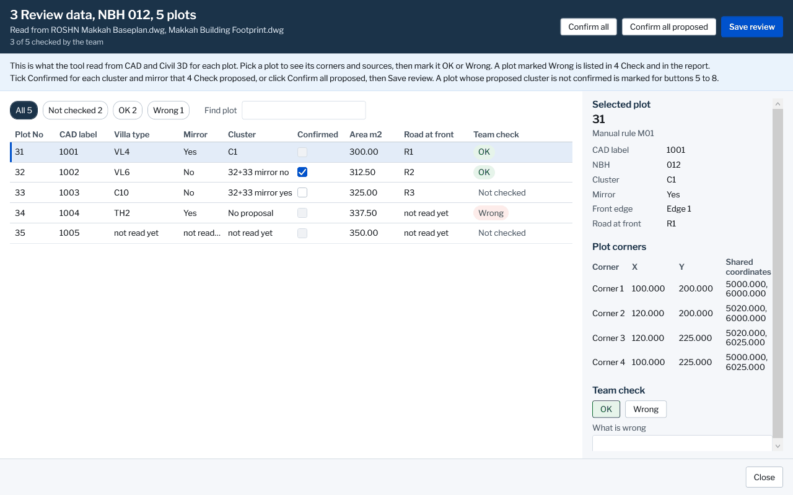
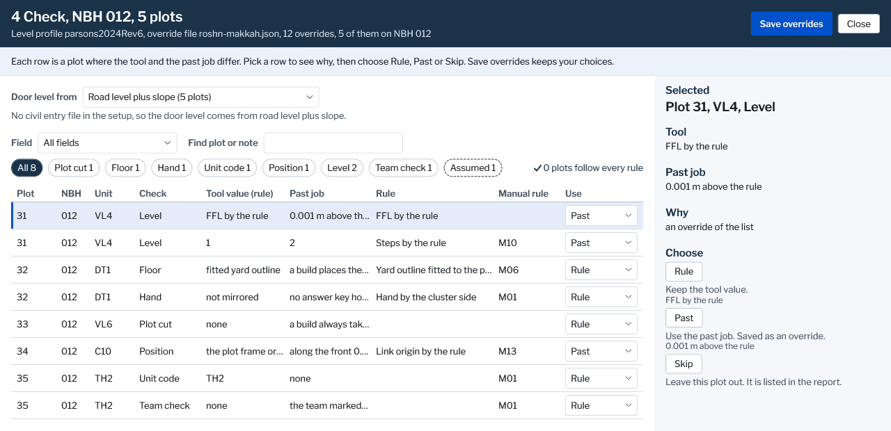

# Drafts for Bader, Q286 and Q293

The four drafts of NEWPROJ-UI and the three of SCAN-UI, each beside its Revit shot. The left picture is the draft in this repo, made up numbers, rendered with no Revit.

The Revit shots show real file names and coordinates, so they never enter git. They sit under the work root and only show on this PC. For all seven side by side, open C:\Users\p003653k\Documents\SiteAdaptation\drafts_for_bader\index.html in a browser.

| Draft | Revit | What it shows |
|---|---|---|
|  | [Revit shot of new-project](file:///C:/Users/p003653k/Documents/SiteAdaptation/drafts_for_bader/revit/new-project.png) | NEWPROJ-UI, Q286: New project window. Draft: sample counts, 337 plots and 14 villa types. Revit: the Survey point row is grey, Plots found and Villa types say Not read yet. |
|  | [Revit shot of how-it-works](file:///C:/Users/p003653k/Documents/SiteAdaptation/drafts_for_bader/revit/how-it-works.png) | NEWPROJ-UI, Q286: How it works page, the 9 steps and their buttons, the same in both. |
|  | [Revit shot of pane](file:///C:/Users/p003653k/Documents/SiteAdaptation/drafts_for_bader/revit/pane.png) | NEWPROJ-UI, Q286: The pane in use. Revit: a hand run at step 6, Lane B Task 6, wider than the draft, with the Revit window around it. |
|  | [Revit shot of pane-first-open](file:///C:/Users/p003653k/Documents/SiteAdaptation/drafts_for_bader/revit/pane-first-open.png) | NEWPROJ-UI, Q286: The pane on first open, no settings file chosen. Revit: run 3 of 5a, 29 Oct, the oldest shot here, the steps have changed since. |
|  | [Revit shot of setup-site](file:///C:/Users/p003653k/Documents/SiteAdaptation/drafts_for_bader/revit/setup-site.png) | SCAN-UI, Q293: Set up site, the section Current files with the Rules dropdown (R441). Revit: the demo files, none ticked, so Apply is grey. |
|  | [Revit shot of review-data](file:///C:/Users/p003653k/Documents/SiteAdaptation/drafts_for_bader/revit/review-data.png) | SCAN-UI, Q293: Review data, the column Cluster with Confirmed (R442). Revit: from before PR 132 and PR 133, so Team check is cut and no Close, every Confirmed box grey under the past job (Q305). |
|  | [Revit shot of check-table](file:///C:/Users/p003653k/Documents/SiteAdaptation/drafts_for_bader/revit/check-table.png) | SCAN-UI, Q293: 4 Check, the dropdown Door level from (R443). No Revit shot of it exists: the row shows under rev6 only and ROSHN runs the past job (Q302), so the Revit side shows the window without the row. |
